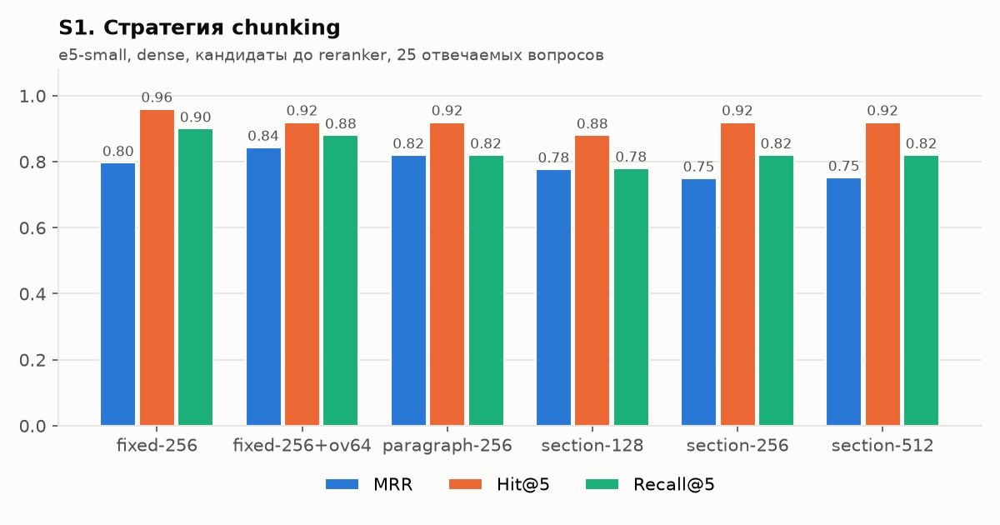
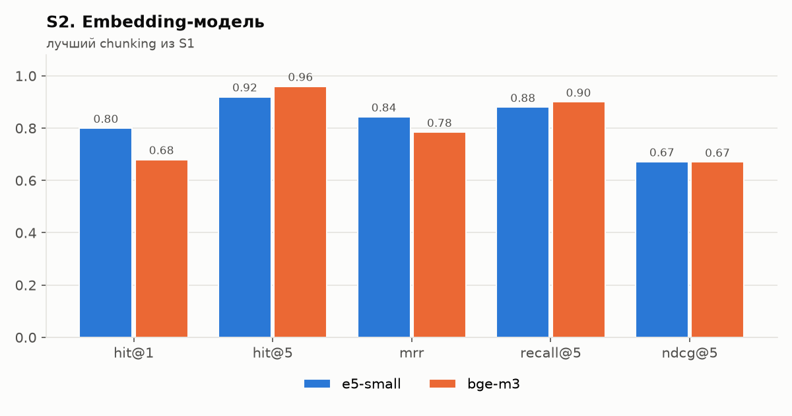
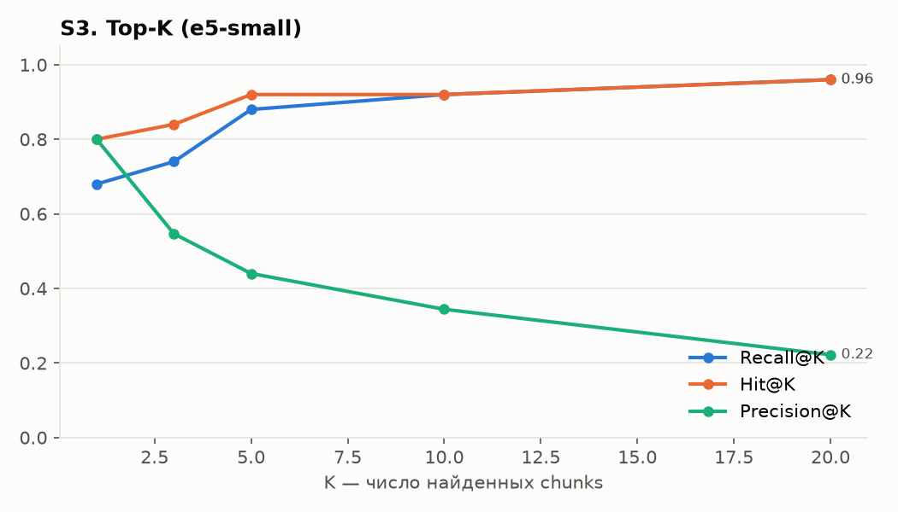
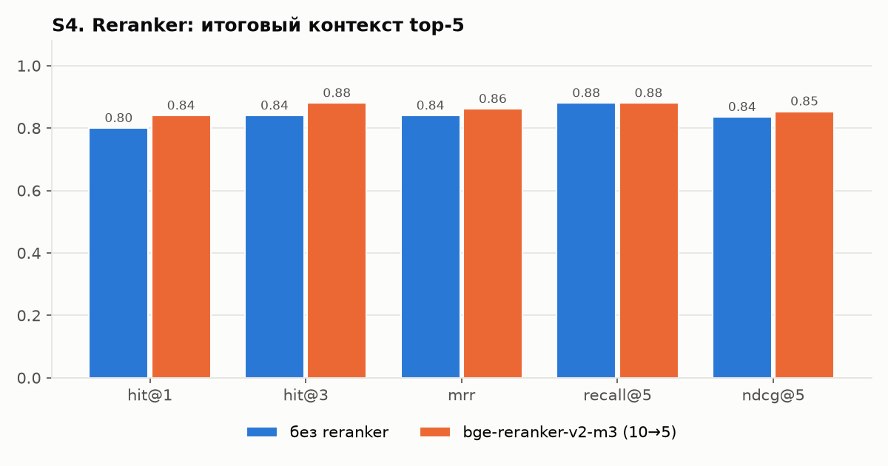
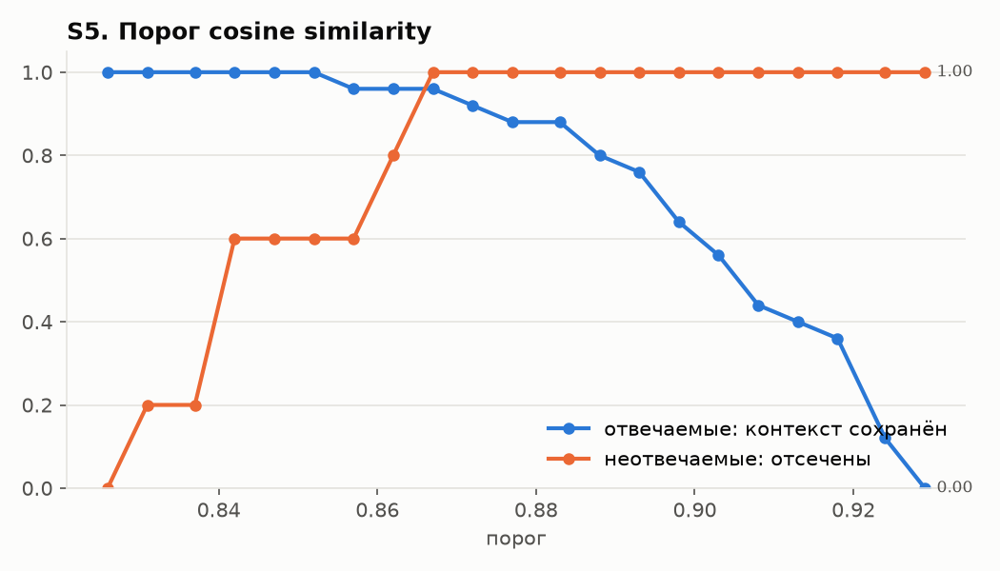
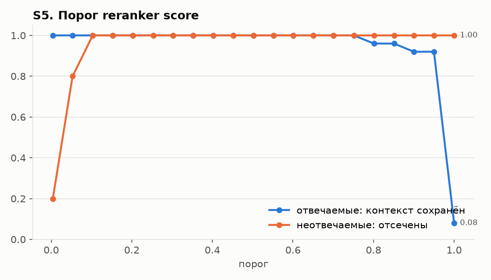
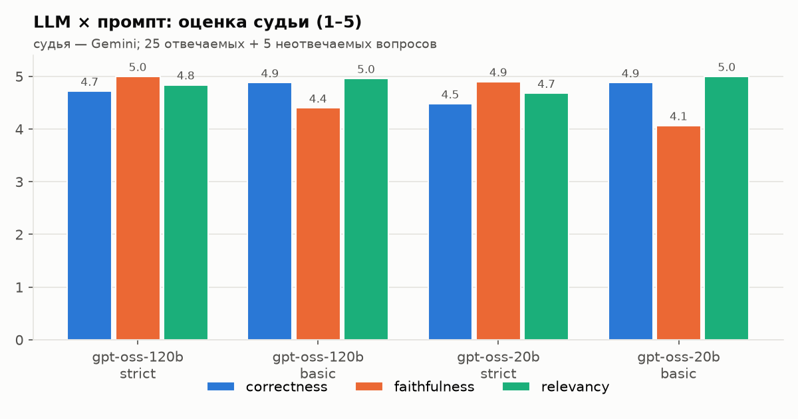
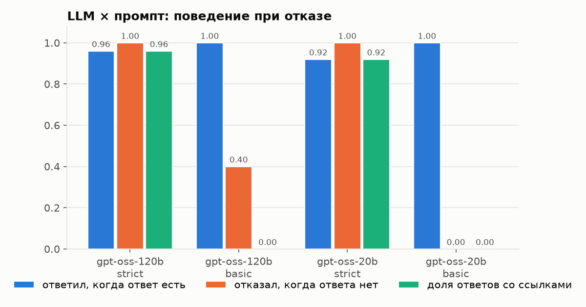

# Отчёт: RAG-система «Немецкие автомобили: Audi, BMW, Mercedes-Benz»

Каждое решение описано по схеме: **что** → **почему** → **альтернативы** → **эксперимент** → **результат** → **выбор**.
Все цифры получены скриптами из `experiments/` и лежат в `experiments/results/*.csv`.

## 1. Постановка задачи

Система отвечает на вопросы о немецких автомобилях — компаниях Audi, BMW, Mercedes-Benz и связанных
марках, их моделях, основателях, технологиях и автоспорте — только по собственной базе знаний и указывает источники; если ответа
в базе нет — сообщает об этом, а не выдумывает.

Окружение: RTX 5060 Ti 16 ГБ (CUDA 12.8), i5-14400F, 32 ГБ RAM, Windows 11, Python 3.13.

## 2. Сбор данных (grabber)

- **Что:** 117 статей русской Википедии, сгруппированных в 7 типов (`entity_type`):
  company 21 (Audi, BMW, Mercedes-Benz, Auto Union, Horch, Maybach, AMG, BMW M, Rolls-Royce, Mini…),
  model_audi 21, model_bmw 21, model_mercedes 21, person 9 (Бенц, Даймлер, Майбах, Хорьх, Пиех…),
  technology 15 (quattro, xDrive, 4MATIC, TDI/TSI, ABS, ESP, двигатели BMW/AMG), motorsport 9
  (Mercedes в Формуле-1, DTM, 24 часа Ле-Мана, Audi R10/R18 TDI). Объём — 1,6 млн символов.
  Точные русские заголовки проверены через API (`redirects=1`, `prop=pageprops` → признак неоднозначности):
  например, «BMW 3 серии» в ру-вики называется «BMW 3», «Volkswagen AG» — редирект на «Volkswagen (концерн)».
- **Почему Википедия и MediaWiki API:** авторитетный, структурированный (секции h2/h3, карточки)
  источник на русском; API отдаёт готовый HTML (`action=parse`) и дешёвую версию страницы (`lastrevid`).
- **Альтернативы:** парсинг HTML страниц (хрупко), дампы Википедии (избыточно), научно-популярные сайты (нет API, разная вёрстка).
- **Как устроено:**
  1. список статей задаётся в `configs/default.yaml` по группам;
  2. `prop=info` пачками по 50 → `pageid`, `lastrevid` (редиректы разрешаются автоматически);
  3. если `lastrevid` совпадает с манифестом и файл документа есть — статья **не скачивается** (`skipped`);
  4. иначе `action=parse` → сырой ответ сохраняется в `data/raw/` → парсер режет HTML на секции по h2/h3
     (h3 получает контекст: «Первое поколение / V10»), карточка (infobox) превращается в секцию
     «Характеристики» со строками «параметр | значение»;
  5. SHA-256 содержимого: не изменилось → `unchanged`; совпало с другим документом → `duplicate`;
     статьи, пропавшие из листинга, → `removed` (файл удаляется).
- **HTTP:** пауза 0,3 с между запросами, повторы с экспоненциальной задержкой на 429/5xx, уважение `Retry-After`,
  User-Agent с контактом (требование Википедии). Ошибка одной статьи не роняет прогон (`failed` в манифесте).
- **Проверка инкрементальности на практике:** после первого сбора (116 новых) проверка списка документов
  (короткие документы < 1000 символов и заголовки-редиректы) выявила неудачные заголовки: `Smart`, `BMW X5`, `TDI` —
  страницы неоднозначности (1206, 310 и 605 символов), `Mercedes-Benz 300SL` — короткая статья-обозначение (443 символа),
  `Audi Sport` — редирект на основную статью `Audi` (дубль). Заменены на `Smart (автомобильная марка)`, `BMW X5 (E53)`,
  `Volkswagen TDI`, `Mercedes-Benz W198`, `Audi Sport GmbH`. Повторный `grab`: **skipped 112, new 5, removed 4** —
  скачаны только пять новых статей, четыре страницы неоднозначности/заглушки удалены из базы.

## 3. Предобработка и chunking

- **Очистка:** удаляются сноски `[1]`, навигационные шаблоны, плашки, галереи, формулы, служебные секции
  («Примечания», «Литература», «Ссылки», «См. также» и т. п.); Unicode-нормализация NFKC, кавычки и
  пробелы приводятся к единому виду, удаляются повторы длинных строк, склеиваются «осиротевшие» обрывки строк.
- **Metadata каждого chunk:** `doc_id`, `title`, `sections`, `url`, `source`, `lang`, `entity_type`,
  `updated_at`, `position`, `n_tokens`, `strategy` — хранятся в payload Qdrant, по ним работает фильтр
  (`retrieval.filters`, напр. `{entity_type: [model_audi, model_bmw]}`).
- **Заголовок-контекст:** в начало chunk добавляется «Документ — Секция» (напр. «BMW M3 — M3 E46 (2000–2006)»):
  короткий фрагмент без него теряет, о какой модели или компании идёт речь (у разных статей много одинаковых секций: «История», «Двигатели»).
- **Размер в токенах** считается токенизатором XLM-R — он общий у e5 и bge-m3, поэтому chunk гарантированно
  влезает в модель (лимит 512).

### Стратегии chunking

| Стратегия | Как работает |
|---|---|
| fixed | окно фиксированного размера по токенам, границы секций игнорируются |
| fixed + overlap | то же с перекрытием соседних окон |
| paragraph | абзацы жадно упаковываются до лимита, границы секций игнорируются |
| section | chunk не пересекает границу секции; длинная секция делится по абзацам/предложениям |

## 4. Датасет для оценки

30 вопросов (`data/eval/questions.jsonl`): 8 фактологических, 7 на конкретную информацию (числа, даты),
5 по нескольким документам, 5 на понимание контекста («почему…»), 5 без ответа в базе.
Эталон размечен на уровне **документ + секция** (а не конкретного chunk), поэтому один датасет годится
для любой стратегии chunking. Если факт продублирован (карточка и введение), секции перечисляются списком
как равноправные. Ссылки эталона проверяет скрипт `experiments/check_dataset.py`
(существует ли документ и секция) — все 30 вопросов проходят проверку.

**Метрики поиска:** Hit@K (есть ли релевантный chunk в top-K), Recall@K (доля эталонных пар
«документ+секция», покрытых top-K), Precision@K, MRR, nDCG@K. Считаются по 25 отвечаемым вопросам.

## 5. Эксперименты с поиском

Порядок последовательный: лучший вариант этапа фиксируется и используется дальше
(критерий — MRR, при равенстве Recall@5). Скрипт: `experiments/run_retrieval.py`.

### S1. Стратегия chunking

- **Почему важно:** слишком крупный chunk «размывает» вектор, слишком мелкий теряет контекст.
- **Эксперимент:** e5-small, dense-поиск, top-20 кандидатов без фильтров и reranker.

| chunking | Hit@1 | Hit@5 | MRR | Recall@5 | nDCG@5 | chunks | ср. токенов |
|---|---|---|---|---|---|---|---|
| fixed-256 | 0.68 | **0.96** | 0.797 | **0.90** | **0.718** | 1857 | 249 |
| **fixed-256 + overlap 64** | **0.80** | 0.92 | **0.843** | 0.88 | 0.672 | 2420 | 252 |
| paragraph-256 | 0.72 | 0.92 | 0.820 | 0.82 | 0.676 | 2271 | 203 |
| section-128 | 0.68 | 0.88 | 0.777 | 0.78 | 0.534 | 4845 | 94 |
| section-256 | 0.64 | 0.92 | 0.750 | 0.82 | 0.591 | 2631 | 173 |
| section-512 | 0.64 | 0.92 | 0.752 | 0.82 | 0.616 | 1636 | 278 |

- **Результат:** на этом корпусе — в отличие от «научных» статей — **секционное деление проигрывает**
  окнам фиксированного размера. Статьи о моделях автомобилей состоят из многих коротких секций
  («Двигатели», «Рестайлинг», «Модификации», «Безопасность»), которые сами по себе мало что говорят
  о модели: section-128 даёт 4845 мелких chunks, и похожие по смыслу фрагменты разных моделей
  (описания двигателей и модификаций есть почти в каждой статье) конкурируют между собой.
  Fixed-окна захватывают соседние секции и введение, и вектор лучше отражает конкретную модель.
  Overlap 64 токена поднимает Hit@1 с 0,68 до 0,80 и MRR на +0,05 (факт на границе окна попадает
  целиком хотя бы в один chunk) ценой +30 % chunks.
- **Выбор:** **fixed-256 + overlap 64** (лучший MRR и Hit@1). У fixed-256 без overlap чуть выше Hit@5/Recall@5,
  но первая позиция важнее для отсечения по порогу и для порядка в контексте.

### S2. Embedding-модель

- **Альтернативы:** multilingual-e5-small (118M, 384 изм.) — быстрая; bge-m3 (568M, 1024 изм.) — крупная SOTA-модель.
- **Эксперимент:** лучший chunking из S1, dense, top-20.

| модель | Hit@1 | Hit@5 | MRR | Recall@5 | nDCG@5 | индексация, с | поиск, с/вопрос |
|---|---|---|---|---|---|---|---|
| **e5-small** | **0.80** | 0.92 | **0.843** | 0.88 | **0.672** | 19 (вместе с chunking, S1) | 0.013 |
| bge-m3 | 0.68 | **0.96** | 0.785 | **0.90** | 0.670 | 50 | 0.028 |

- **Результат:** неожиданно **маленькая e5-small лучше на первой позиции** (Hit@1 0,80 против 0,68, MRR +0,06);
  bge-m3 чуть полнее в top-5 (Hit@5 0,96, Recall@5 0,90). Вероятная причина: в корпусе десятки похожих статей
  (поколения одной серии BMW, классы Mercedes), и для первой позиции важнее точное совпадение обозначений
  (E30, W124, R8), чем общая семантика, по которой bge-m3 сильнее. На выборке из 25 вопросов разница в Hit@1
  (3 вопроса) не является статистически надёжной.
  e5-small ещё и в 2 раза быстрее при поиске и в 2,5 раза — при индексации.
- **Выбор:** **e5-small**. Недостающую полноту в top-5 добирает reranker (S4).

### S3. Top-K

Из того же прогона S2 (e5-small):

| K | 1 | 3 | 5 | 10 | 20 |
|---|---|---|---|---|---|
| Hit@K | 0.80 | 0.84 | 0.92 | 0.92 | 0.96 |
| Recall@K | 0.68 | 0.74 | 0.88 | 0.92 | 0.96 |
| Precision@K | 0.80 | 0.55 | 0.44 | 0.34 | 0.22 |

- **Результат:** полнота растёт до K = 10 (Recall 0,92), K = 20 добавляет ещё 0,04 при вдвое большем шуме
  (Precision 0,22) и вдвое большей нагрузке на reranker. В LLM имеет смысл отдавать около 5 chunks.
- **Выбор:** достаём **10 кандидатов**, после reranker в LLM уходят **5**.

### S4. Reranker

- **Почему:** bi-encoder кодирует вопрос и chunk по отдельности; cross-encoder видит их вместе и
  точнее оценивает релевантность, но дороже — поэтому применяется только к top-10.
- **Эксперимент:** e5-small dense, 10 кандидатов → top-5 (без reranker — первые 5 по cosine;
  с reranker — 5 лучших по bge-reranker-v2-m3). Метрики на итоговых 5 chunks.

| вариант | Hit@1 | Hit@3 | Hit@5 | MRR | Recall@5 | nDCG@5 | поиск, с/вопрос |
|---|---|---|---|---|---|---|---|
| без reranker (top-5 по cosine) | 0.80 | 0.84 | 0.92 | 0.840 | 0.88 | 0.836 | 0.014 |
| **bge-reranker-v2-m3, 10 → 5** | **0.84** | **0.88** | 0.92 | **0.861** | 0.88 | **0.853** | 0.179 |

- **Результат:** по основному критерию этапа (Recall@5) варианты равны — 0,88: reranker не может
  вернуть то, чего нет в 10 кандидатах (два «промаха» — q05 и q16, см. ниже). Но он улучшает порядок
  (Hit@1 0,80 → 0,84, MRR +0,02, nDCG@5 +0,02) и, главное, даёт **откалиброванный скор релевантности**
  (S5), который у cosine практически бесполезен.
- **Промахи поиска** (эталон не попал в итоговые 5 chunks, `gold_in_context = False` в `retrieval_s5_scores.csv`):
  q05 («в честь кого названа марка Mercedes») — эталон в статье «Еллинек, Эмиль», а вопрос лексически ближе
  к большой статье Mercedes-Benz; q16 (сравнение годов основания Audi и Mercedes-Benz) — multi_doc-вопрос требует
  двух разных статей в контексте, а покрыта только часть эталона.
- **Выбор:** **bge-reranker-v2-m3, 10 → 5**. Цена — +0,17 с на вопрос на GPU.

### S5. Пороги отсечения (cosine и reranker)

- **Задача:** по максимальному скору понять, что в базе нет ответа, и отказать до вызова LLM.
- **Эксперимент:** без новых прогонов — по сохранённым скорам (`retrieval_s5_scores.csv`) для всех 30 вопросов
  перебирается порог; считается доля отвечаемых вопросов, у которых контекст сохранился, и доля
  неотвечаемых, которые отсечены.

| скор | отвечаемые: min / среднее | неотвечаемые: max / среднее | лучший порог | отвечаемые сохранены | неотвечаемые отсечены |
|---|---|---|---|---|---|
| cosine (e5-small) | 0.856 / 0.904 | 0.864 / 0.845 | 0.867 | 96 % | 100 % |
| reranker | 0.800 / 0.983 | 0.068 / 0.026 | 0.103 | 100 % | 100 % |

- **Результат:** cosine e5-small сжат в узкий диапазон 0,83–0,93 (свойство e5: все тексты на одном языке
  похожи), отвечаемые и неотвечаемые перекрываются: вопрос «где штаб-квартира Audi» (q08) получил 0,856 —
  меньше, чем «сколько стоит BMW X5 в Москве» (0,864). Лучший cosine-порог 0,867 держится на зазоре 0,003
  и теряет q08. Скоры reranker разведены на порядок: у неотвечаемых ≤ 0,07, у отвечаемых ≥ 0,80
  (минимум — q16, единственный вопрос с неполным контекстом). Любой порог 0,07–0,8 разделяет классы без ошибок.
- **Выбор:** cosine-порог не используется; порог reranker `reranker.min_score = 0.3` — с запасом от обеих границ.
  В эксперименте с генерацией порог выключен, чтобы сравнить LLM и промпты в чистом виде
  (в т. ч. умение модели самой отказать).

## 6. Генерация

- **Промпты** (`src/generation/prompts.py`):
  - **strict** — отвечать только по контексту, ссылка `[n]` после каждого утверждения, при отсутствии ответа —
    фиксированная фраза «В базе знаний недостаточно информации…», числа — точно как в контексте;
  - **basic** — «вот фрагменты, ответь на вопрос» без запрета собственных знаний и без требования ссылок.
- **LLM:** Groq, open-weight `openai/gpt-oss-120b` и `openai/gpt-oss-20b` (reasoning_effort=low, temperature 0).
- **Судья:** `gemini-3.5-flash-lite` (другое семейство моделей → меньше эффекта «хвалит свои ответы»), оценки 1–5:
  correctness (совпадение с эталоном), faithfulness (всё ли подтверждается контекстом), relevancy (по делу ли ответ).
  Отказы проверяются правилом: отвечаемый вопрос → отказа быть не должно, неотвечаемый → должен быть отказ.
- **Источники:** в ответ попадают только процитированные фрагменты `[n]` (документ, секция, URL).
- Ответы LLM кэшируются в SQLite — повторный прогон не тратит бесплатную квоту.

### Эксперимент: LLM × промпт

Retrieval — итоговый из раздела 5 (fixed-256 + overlap 64, e5-small, 10 → reranker → 5), порог reranker выключен,
чтобы сравнить именно LLM и промпты. 30 вопросов × 4 варианта, каждый ответ оценён судьёй.
Скрипт: `experiments/run_generation.py`; ответы и комментарии судьи — `results/generation_all.csv`.

| вариант | correctness | faithfulness | relevancy | ответил, когда ответ есть | отказал, когда ответа нет | ответов со ссылками |
|---|---|---|---|---|---|---|
| **gpt-oss-120b / strict** | 4.72 | **5.00** | 4.84 | 24/25 | **5/5** | **96 %** |
| gpt-oss-120b / basic | **4.88** | 4.40 | 4.96 | 25/25 | 2/5 | 0 % |
| gpt-oss-20b / strict | 4.48 | 4.90 | 4.68 | 23/25 | **5/5** | 92 % |
| gpt-oss-20b / basic | **4.88** | 4.07 | **5.00** | 25/25 | 0/5 | 0 % |

(correctness и relevancy — по 25 отвечаемым вопросам, faithfulness — по всем 30. Время ответа на бесплатном
тарифе Groq не сравнивается: в нём преобладали ожидания после HTTP 429, медиана 8–12 с на вопрос.)

- **Промпт важнее модели.** С basic-промптом модели отвечают из собственных знаний на вопросы, которых нет в базе:
  gpt-oss-20b/basic не отказала **ни разу** (0/5) и выдумала цену BMW X5 в Москве («от 7 до 8 млн рублей»),
  продажи Tesla Model 3 за 2023 год («≈ 1 300 000»), расход Lada Vesta; gpt-oss-120b/basic отказала в 2 из 5
  случаев, но назвала мощность Toyota Supra A80 и скорость Ferrari F40 по памяти. Кроме того, basic «дополняет»
  контекст на отвечаемых вопросах: на q25 (почему M156 называется 6.3) обе модели добавили выдуманные
  «маркетинговые» причины, 20b — неверную датировку M100 («1930-е»); на q19 20b/basic придумала завод
  Rolls-Royce «в штате Кентукки». Отсюда faithfulness 4,07–4,40 против 4,90–5,00 у strict. Ссылки `[n]` без
  требования в промпте не ставятся совсем (0 %), а пользователь не может проверить ответ.
- **Почему correctness у basic формально выше:** судья по correctness сравнивает с эталоном, а basic «добирает»
  недостающее из памяти модели (например, год основания Audi в q16, которого не было в контексте). Для системы,
  обязанной отвечать **только по базе**, это недостаток, а не преимущество.
- **Ошибки strict-промпта** — это ложные отказы и неполные ответы на multi_doc-вопросах, когда контекст неполный:
  - q16 (сравнение годов основания Audi и Mercedes-Benz): поиск не принёс chunk с годом основания Audi (S4).
    120b честно ответила про Mercedes-Benz (1926) и указала, что про Audi в контексте данных нет (correctness 3);
    20b отказала целиком.
  - q17 (quattro vs xDrive): в контексте оказались фрагменты о xDrive, но не о механике quattro — обе модели отказали.
    Это ошибка **поиска**, а не генерации: вопрос с двумя сущностями «перетягивает» одна статья.
  - q18 (что раньше — 4MATIC или xDrive): **галлюцинация 20b/strict** — модель склеила факты контекста
    «в 1985 году у BMW уже были полноприводные E30 325iX / E34 525iX» с названием xDrive и ответила, что
    «обе системы появились в 1985 году» (faithfulness 2). 120b ответила верно: 4MATIC — 1985, xDrive — 2003.
- **Модели:** со strict-промптом 120b лучше по всем критериям (correctness 4,72 против 4,48, 24/25 против 23/25
  ответов) и не допустила ни одной галлюцинации; 20b ошиблась в логике сравнения (q18).
- **Связь с порогом S5:** все 5 неотвечаемых вопросов получили скор reranker ≤ 0,07 и при включённом пороге 0,3
  отсекаются ещё до LLM; strict-промпт — второй рубеж (он и без порога отказал на 5/5).
- **Выбор:** **gpt-oss-120b + strict**, порог reranker 0,3.

## 7. Итоговая конфигурация

Прописана в `configs/default.yaml` (и `experiments/results/best_config.json` для retrieval-части):

| Параметр | Значение |
|---|---|
| Chunking | fixed, 256 токенов, overlap 64, заголовок «Документ — Секция» |
| Embeddings | intfloat/multilingual-e5-small |
| Vector DB | Qdrant (embedded), cosine |
| Поиск | dense, top-10 кандидатов |
| Фильтры | мин. длина 60 символов, дедупликация (Jaccard ≥ 0,85) |
| Reranker | BAAI/bge-reranker-v2-m3, 10 → 5, порог `min_score = 0.3` |
| LLM / промпт | Groq `openai/gpt-oss-120b`, temperature 0, промпт strict |

## 8. Интерфейс

`streamlit run app.py`: поле вопроса, ответ со ссылками `[n]`, список источников (ссылки на статьи Википедии),
раскрывающийся список найденных фрагментов со скорами cosine и reranker, настройки (reranker вкл/выкл, промпт,
модель, Top-K), время этапов. CLI: `python -m src.cli ask "…" --show-context`.

## 9. Выводы и ограничения

- Итоговая система отвечает на 24 из 25 отвечаемых вопросов (correctness 4,72 / 5, faithfulness 5,0 — ни одного
  утверждения не из контекста) и отказывает на всех 5 вопросах без ответа в базе (Toyota, Tesla, Lada, Ferrari, цены);
  96 % ответов снабжены ссылками на фрагменты и URL статей.
- На этом корпусе (много похожих статей о поколениях моделей) **fixed-окна с перекрытием** оказались лучше
  секционного chunking, а **маленькая e5-small** — лучше bge-m3 на первой позиции; reranker почти не изменил
  полноту, но дал надёжный скор для отказа (полное разделение отвечаемых и неотвечаемых вопросов).
  На генерации решающим оказался **строгий промпт**: с basic-промптом модели выдумывают цены и характеристики.
- **Ошибка в коде, найденная экспериментом:** детектор отказа сначала считал отказом любой ответ со словами
  «нет информации» — включая полный ответ на q22, который заканчивался оговоркой «о других причинах в базе нет
  информации», и при этом удалял из ответа источники. Исправлено: отказ — только если формулировка отказа
  стоит в начале ответа (тест `test_refusal_detection`); результаты пересчитаны из кэша без новых запросов.
- **Ограничения:** датасет небольшой (30 вопросов, 5 неотвечаемых) — различия в несколько сотых метрик находятся
  в пределах шума; судья — тоже LLM и может ошибаться; эталон размечен вручную одним человеком; корпус —
  117 статей, вопросы о других марках и моделях вне списка уходят в отказ.
- **Что улучшить:** multi_doc-вопросы — главный источник ошибок: стоит ограничить число chunks из одного документа
  (`filtering.max_per_doc`, уже реализовано) или разбивать вопрос на подвопросы по сущностям; проверить
  hybrid-поиск (BM25 + dense, `retrieval.mode: hybrid`) на вопросах с индексами моделей (E30, W124);
  расширить датасет.
